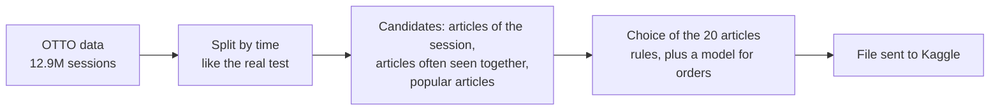
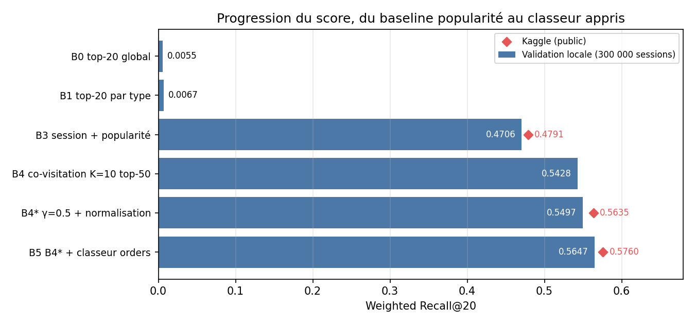

# OTTO Recommender System: Kaggle Project

**Author:** [Aamer Mohamed ] **Supervisor:** [Professor ELhabib Nfaoui] **Repository:** https://github.com/MohamedAamer01/otto-recommender-sys

> This document summarises the project in a few minutes of reading. The full technical detail is in `README.md` and in the notebooks.

---

## 1. The problem in plain words

OTTO is an online shop. While a customer browses, we can see what they have already viewed (clicks), added to the cart, or bought. **The goal: guess the 20 articles the customer will interact with next**, for each of these three actions:

| Action to predict | Weight in the score |
|---|---|
| Next **click** | 10 % |
| Items added to the **cart** | 30 % |
| **Orders** | 60 % |

**How we are graded:** we propose 20 articles and count how many are correct (a measure called *Weighted Recall@20*). A score of 1 would be perfect, 0 would be useless.

**Why it is hard:** there are 1.86 million articles, and for half of the test sessions we only know 2 actions or fewer.

## 2. The data

| | |
|---|---|
| Training sessions | 12.9 million (4 weeks of browsing) |
| Recorded actions | 216.7 million (90 % clicks, 8 % carts, 2 % orders) |
| Different articles | 1.86 million |
| Test | 1.67 million sessions from the following week, **cut part-way through**: we must predict what comes next |

## 3. The method in 5 steps



1. **Understand the data.** The large file (over 10 GB) is read in chunks, then stored compactly (2 GB) so that experiments run fast.
2. **Explore and state hypotheses.** Each idea is tested with a measurement, not assumed.
3. **Build a reliable validation.** We learn from the first 3 weeks and test on the 4th, with sessions cut the way the real test is cut. This avoids accidentally "cheating" with information from the future.
4. **Build the recommendations step by step**, comparing each version with the previous one.
5. **Submit to Kaggle** to check that the local results hold on the real test.

## 4. The three ideas that improve the score

- **Recommend first what the customer has already seen.** Many orders concern an article already viewed in the session (95.6 % of the time, on complete sessions).
- **Complete with articles "often seen together".** This is the "customers who looked at A also looked at B" principle. The links between 1.86 million articles must be computed without running out of memory: the computation is split into 4 passes.
- **Use a learning model for orders.** A *gradient boosting* model re-ranks the candidates. It improves orders but **not** clicks or carts, so it is used for orders only.

## 5. Results



| Step | Local score | Kaggle score (public) |
|---|---|---|
| Most popular articles, the same for everyone | 0.0067 | n/a |
| + articles already seen in the session | 0.4706 | 0.4791 |
| + articles often seen together | 0.5497 | 0.5635 |
| **+ learning model for orders** | **0.5647** | **0.5760** (private: 0.5757) |

- The score is **more than 80 times** higher than the starting point.
- Local scores and Kaggle scores move together: **the validation is reliable**.
- The competition is over, so this is a late submission that does not count in the official ranking. To my knowledge, the best public solutions were around 0.60.

## 6. What the project demonstrates

| Skill | Where it is visible |
|---|---|
| Understanding and checking large data | notebooks 01 and 02 |
| Exploratory analysis with verified hypotheses | notebook 02: 5 hypotheses, one of them refuted |
| Avoiding data leakage | notebook 04: 3.5 million sessions straddle the cut-off date and are handled separately |
| Scientific method | every improvement is tested with a confidence interval; failed attempts are kept |
| Working under memory and time constraints | block-wise computation in 4 passes, compact arrays |
| Comparing instead of assuming | `reports/results.csv`: one row per model tested |

**Examples of negative results, kept on purpose:**
- normalising the article links by popularity *lowers* the score;
- separate tables for each action type add almost nothing (+0.0004);
- the learning model is worse than the simple rules for clicks and carts.

## 7. Limitations

- The validation set was used to compare about twenty variants, so the best local scores are slightly optimistic (Kaggle confirmed them).
- The exact way the test sessions are cut is not public: it was reproduced approximately.
- The learning model was trained on only 30,000 sessions, without a hyper-parameter search.

## 8. Next steps

A ranking model better matched to the score (LightGBM in ranking mode), more training data for orders, and finer tuning of the links between articles.

## 9. Repository layout and reproduction

```
notebooks/   01 data, 02 exploration, 03 theory, 04 validation,
             05 baselines, 06 co-visitation, 07 final model and submission
src/         reusable code (otto_core.py, otto_rank.py, otto_infer.py)
reports/     results.csv (all experiments) and figures/
```

**To rerun:** open the notebooks in order on Google Colab, store your Kaggle token in the Colab *Secrets* (`KAGGLE_API_TOKEN`), accept the competition rules, then run notebook 01, which downloads the data (it is not in the repository).
