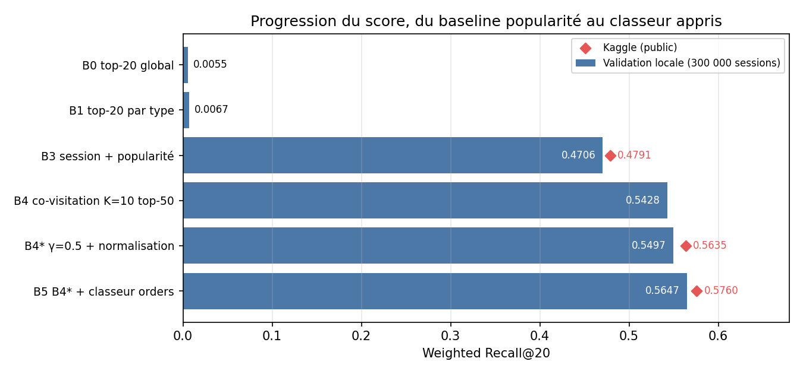
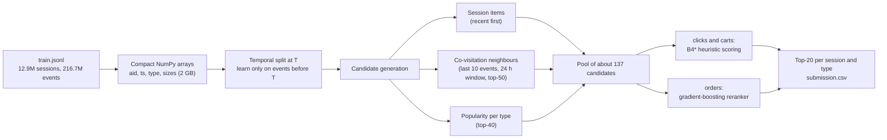
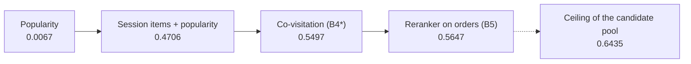
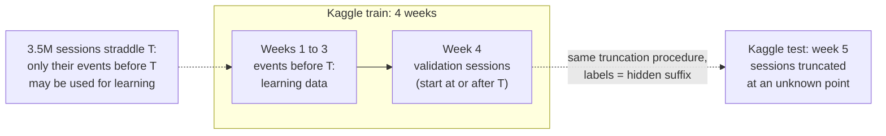
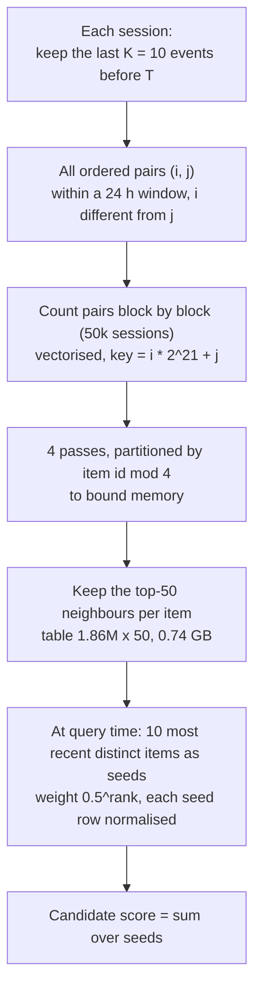

# OTTO – Multi-Objective Recommender System

A session-based recommender for the Kaggle competition **OTTO – Multi-Objective Recommender System**, built step by step on Google Colab: data understanding, EDA, a leakage-free temporal validation, baselines, co-visitation at scale, and a learned reranker.

**Result:** Weighted Recall@20 of **0.5760 (public) / 0.5757 (private)** on Kaggle, from 0.0067 for a popularity baseline. The competition is over, so this is a late submission and does not count for the ranking. Top public solutions reportedly reached about 0.60 (check the competition leaderboard).

The goal of the project was not only the score but the method: every improvement is a hypothesis, an experiment with a confidence interval, and a decision. Negative results are kept in the table below.



| Model | clicks | carts | orders | Local score | Kaggle public | Kaggle private |
|---|---|---|---|---|---|---|
| B0 – global top-20 | 0.0082 | 0.0062 | 0.0047 | 0.0055 | n/a | n/a |
| B1 – top-20 per event type | 0.0082 | 0.0078 | 0.0060 | 0.0067 | n/a | n/a |
| B3 – session items + popularity | 0.3275 | 0.3121 | 0.5738 | 0.4706 | 0.47911 | 0.48035 |
| B4 – co-visitation (K=10, 24 h, top-50) | 0.5028 | 0.3947 | 0.6235 | 0.5428 | n/a | n/a |
| B4* – + recency decay and per-seed normalisation | 0.5134 | 0.4042 | 0.6285 | 0.5497 | 0.56353 | 0.56271 |
| **B5 – B4\* + gradient-boosting reranker on orders** | 0.5134 | 0.4042 | 0.6535 | **0.5647** | **0.57597** | **0.57566** |

*Local score = Weighted Recall@20 on a fixed 300,000-session validation set (see [Validation](#2-validation)). Gains measured locally carried over to Kaggle: B3 → B4\* is +0.079 locally and +0.082 to +0.084 on Kaggle.*

---

## The problem

Given the beginning of an online shopping session (clicks, add-to-carts, orders), predict for each of the three event types the 20 articles (`aid`) the user will interact with **later in the same session**.

- `clicks`: the **next** clicked article (a single label).
- `carts` and `orders`: **all** articles added to the cart or ordered in the rest of the session.
- Metric: **Weighted Recall@20** = 0.10 · Recall(clicks) + 0.30 · Recall(carts) + 0.60 · Recall(orders). Each recall is micro-averaged: total hits divided by the sum of min(20, number of labels). Sessions without a label of a given type do not count for that type, and the order of the 20 items is irrelevant.

Orders carry 60 % of the score although they are only 2.4 % of the events.

## Approach at a glance



Local validation score along the way:



---

## 1. What the data says (EDA)

| Fact | Value |
|---|---|
| Train | 12,899,779 sessions, 216,716,096 events, 1,855,603 articles, 31 Jul 22:00 → 28 Aug 21:59 UTC |
| Event types | clicks 89.9 %, carts 7.8 %, orders 2.4 % |
| Session length | median 6, mean 16.8, 95th percentile 68, hard cap at 500 events, minimum 2 |
| Test | 1,671,803 sessions, 6,928,123 visible events, the **following week**, median 2 events per session |
| Test articles | 100 % also appear in the train (no unseen article) |

Findings that shaped the design (each was a hypothesis tested on the data):

- **Sessions are not 30-minute visits.** 54.9 % last more than 24 h and 37.4 % more than 7 days (up to 28 days). The file is sorted by session start, and sessions that start early are far longer (median 19 events in the first block vs 4 at the end). The first 1,000 lines gave a median size of 41 while the true median is 6: *never sample the first lines of a file*.
- **Traffic drops 4 to 5 times over the four weeks**, so popularity and session length are not stationary.
- **Popularity is concentrated but not a pure power law:** the top 1 % of articles gets 38.2 % of the events, the median article has 20 events. The top-20 lists of clicks and orders share only 7 articles.
- **The funnel is strong:** for 95.6 % of ordered articles, the same article was clicked or added to the cart earlier in the same (complete) session. Predicting orders is largely *re-recommending articles already seen*. This holds less on truncated sessions, where B3 reaches an orders recall of 0.57.

## 2. Validation

A random split would leak the future (the test is the next week), ignore the truncation of test sessions, and mix sessions with very different profiles. The validation reproduces the test conditions instead:



- **T = 21 Aug 22:00 UTC** (end of train minus 7 days). Everything learned (popularity, co-visitation) uses **only events before T**.
- **3,521,833 sessions straddle T** (32 % of the sessions that start before T). A session-level split would have leaked their future events.
- **Validation sessions** are the 1,801,251 sessions starting at or after T (the real test has 1,671,803). Each is cut after a uniformly random number of events; the remaining events give the labels. A fixed sample of **300,000** such sessions is the local validation set.
- **Calibration against the test:** the visible prefixes of the local set have median 2, mean 4.29 and 95th percentile 16 events, against 2, 4.14 and 15 for the real test. The exact truncation mechanism of the test is assumed, not verified.
- **The metric and labels were unit-tested**: an oracle that predicts the true labels scores exactly 1.0, empty predictions score 0.0, and a hand-computed case matches.
- **Kaggle confirmed the validation:** the local B3 score of 0.4706 became 0.479 / 0.480 on Kaggle, and B4\* went from 0.5497 to 0.5635 / 0.5627. The local set is slightly pessimistic, but gains transfer.
- **Confidence intervals:** models are compared with a paired bootstrap over sessions (same sessions for both models), which is far tighter than comparing two independent intervals.

## 3. Candidate generation: co-visitation at scale

Two articles are *co-visited* when they appear within 24 h in the same session. For each article, the 50 most frequent neighbours are kept.



- Raw pairs without truncation would be 18.0 billion, and **1 % of the sessions produce 49.6 % of them**, hence the truncation to the last K events.
- 107.6 M distinct pairs before T (126.2 M on the full train, 95.3 % of the articles have at least one neighbour). My linear extrapolation from two samples predicted 157 M: the growth was clearly sub-linear.
- The pair counter is checked against a brute-force double loop (with window, K and cut-off T), and the partitioned build against the single-pass build.

## 4. Ranking and the experiments

### The ceiling that shaped the strategy

Because Recall@20 compares *sets*, the order of the 20 items does not matter. With 95 % of the visible prefixes having at most 15 events, most sessions already fit entirely in the 20 slots, and **perfectly re-ranking the session's own articles can add at most 0.0135** (ceiling 0.4841 vs 0.4706). On average **17 of the 20 slots are free**, so the gain must come from the candidates that fill them.

### Hypothesis → experiment → verdict

| # | Hypothesis | Result | Verdict |
|---|---|---|---|
| H1 | Article popularity is a long tail | Top 1 % = 38.2 % of events; not a pure power law | Confirmed |
| H2 | The file is ordered by session start | Start time increases monotonically; session size falls with position | Confirmed |
| H3 | The clicks → carts → orders funnel is not systematic | 95.6 % of ordered articles were seen earlier in the session | **Refuted** (strong form) |
| H4 | The test is the next week, truncated | Dates and durations match; 100 % known articles | Supported |
| H5 | A session can span several days | 54.9 % last more than 24 h | Supported |
| H1b | Last-week popularity beats all-time popularity | Δ = −0.0001 to +0.0005 | **Not significant** |
| B1 | A top-20 per event type beats a global top-20 | +0.0012 (CI excludes 0), tiny in absolute terms | Confirmed, small |
| B3 | Session articles are strong candidates | 0.0067 → 0.4706 | **Confirmed (×70)** |
| – | Re-ranking the session's articles has a large potential | Ceiling gain 0.0135 only (set-based metric) | Refuted by measurement |
| 6.1 | Co-visitation fills the free slots | 0.4706 → 0.5428 (+0.072) | **Confirmed** |
| 6.2a | Recency decay and per-seed normalisation help | 0.5428 → 0.5497 (+0.0069) | Confirmed, small |
| 6.2b | Normalising candidates by their popularity before pruning helps | α = 0.25: −0.0006; α = 0.5: −0.0119; α = 1: −0.0615 | **Refuted** (popularity is a useful prior) |
| 6.2c | Separate co-visitation tables per target type help carts/orders | +0.0004, needs +2.2 GB and a 7-minute build | **Rejected** |
| 7 | A learned reranker beats the hand-made scoring | orders +0.0250 recall; carts −0.0088; clicks −0.0040 | **Orders only** |
| 7b | Removing scale-dependent features makes the reranker safer at test time | −0.0058 recall locally; on Kaggle the 18-feature version beat it by +0.0039, as predicted | Keep all 18 features |

**Pool ceiling.** Picking the best 20 candidates with perfect knowledge, from the pool of about 137 candidates per session, would give 0.6435 (0.6518 with the per-type tables). B4\* reaches 0.5497, so the right articles are often *in* the pool but ranked below position 20. That justified trying a learned reranker on the highest-value type first.

### The reranker (orders only)

- Training data: 30,000 validation-week sessions with at least one order, **disjoint from the evaluation sessions** (5.83 M candidate rows, 0.76 % positives).
- 18 features per (session, candidate): co-visitation score and raw count, number of seeds linking to the candidate, recency rank and age in the session, event counts by type, global and per-type popularity, session length and span, last event type.
- Model: scikit-learn `HistGradientBoostingClassifier` (200 iterations, 63 leaves). Training takes about 2 minutes; features cost about 0.44 ms per session.
- Result on orders: recall 0.6285 → **0.6535** (95 % CI of the gain [+0.0219, +0.0271]), i.e. 29 % of the gap to the pool ceiling. It **hurt** carts and clicks, so B4\* is kept for them.
- A pilot on a single type was run first, with a decision rule fixed in advance (adopt if the orders recall gain is at least +0.02, stop below +0.005).
<!-- TODO: add the measured full-test inference time of the orders reranker (notebook 07, timing and generation cells). -->

## 5. Engineering notes

- The JSONL train file (about 10 GB) is read once in streaming mode, then stored as int32 / int8 NumPy arrays (about 2 GB); a session identifier is never stored, only the session sizes.
- All heavy steps are vectorised NumPy over blocks of sessions, and each was validated against a naive implementation on small data before being run at scale.
- Shared code lives in `src/`: `otto_core.py` (co-visitation, lists, metric), `otto_rank.py` (reranker features), `otto_infer.py` (inference and submission writer). Pipeline checks (the module reproduces the validated score; the inference path reproduces the evaluation hits) run before any submission.
- Reproducibility: fixed random seeds, the 300,000-session validation set is saved, and every model is logged in `reports/results.csv`.

## 6. Limitations

- **The validation set was reused for model selection** (about twenty variants), so the best local scores are slightly optimistic. Local-to-Kaggle transfer was checked, but no fresh hold-out set was used.
- **The truncation mechanism of the test is assumed** (uniform cut). The prefix statistics match, which does not prove the mechanism.
- **The reranker is trained with a 3-week table and applied with a 4-week table.** Kaggle showed no damage for the model with all features, but a rolling 3-week table would remove the question.
- The reranker only gained on orders; the binary objective optimises a global loss, not the ordering inside each session.
- Only one reranker configuration was run per type, with no hyper-parameter search, and 30,000 training sessions.

## 7. Next steps

| Idea | Why it is plausible |
|---|---|
| LightGBM with a ranking objective (`lambdarank`, grouped by session) | The binary classifier lost on carts and clicks; the objective does not match the metric |
| More training sessions for orders | Only 29 % of the gap to the pool ceiling was closed with 30,000 sessions |
| Typed co-visitation scores as reranker features | The typed tables raised the pool ceiling by 0.008 even though hand-mixing did not help |
| Rolling 3-week table for the reranker features | Removes the scale difference between training and test |
| Tune K, window and N, directed pairs, time-weighted counts | The co-visitation family was only tuned on seed weighting |

## Repository layout

```
.
├── README.md
├── notebooks/
│   ├── 01_data_understanding.ipynb     JSONL, quality checks, full-dataset statistics
│   ├── 02_eda.ipynb                    hypotheses H1 to H5
│   ├── 03_recsys_theory.ipynb          popularity, CF, matrix factorisation, co-visitation
│   ├── 04_validation.ipynb             temporal split, labels, metric and its tests
│   ├── 05_baselines.ipynb              B0 to B3, bootstrap, first Kaggle submission
|   ├── 05b_submission_b3.ipynb
│   ├── 06_covisitation.ipynb           diagnostics, co-visitation, experiments 6.1 to 6.2c
|   ├── 06_phase6_diagnostic.ipynb
│   └── 07_reranker_and_submission.ipynb  reranker pilot, final submissions
├── src/
│   ├── otto_core.py   otto_rank.py   otto_infer.py
└── reports/
    ├── results.csv                     one row per model and split
    └── figures/progression_scores.png
```

## How to reproduce

1. Open the notebooks in order on Google Colab (a standard runtime with about 12 GB of RAM is enough).
2. Store your Kaggle API token in the Colab **Secrets** as `KAGGLE_API_TOKEN`, accept the competition rules, and run notebook 01 to download the data (it is not included in the repository).
3. Notebooks 01 and 02 build the NumPy arrays and save them to Google Drive; later notebooks reload them in seconds.
4. Set `BASE` and `NPY_DIR` in the setup cells to your Drive folder, and put `src/` on the Python path.

## What I learned

- Validate like the test, then verify it: the leakage from sessions straddling the cut-off was 3.5 million sessions, not a theoretical risk.
- Read the metric before optimising: a set-based Recall@20 made ranking the session's items nearly useless and made the free slots the real lever.
- Measure ceilings before building: the pool ceiling decided between a reranker and more candidate generators, and a one-type pilot with a pre-set stopping rule kept the cost bounded.
- Keep the negative results: several ideas were rejected with numbers, and two of my own estimates were wrong (a 157 M pair extrapolation; a classifier that lost on two of three types).
